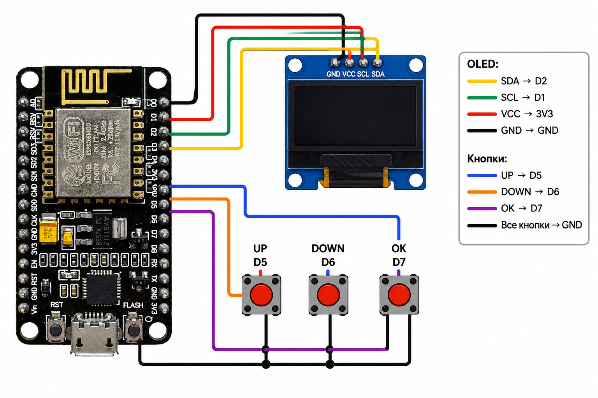

# 📖 Supermini Reader — ESP8266

**Автономный ридер текстов и картинок на ESP8266 с OLED-экраном 128×64 и тремя кнопками**


> [!NOTE]
> **Это порт** проекта [**razeb1t/Supermini-Reader**](https://github.com/razeb1t/Supermini-Reader) (версия 1.3) с ESP32-S3 SuperMini на **ESP8266 (NodeMCU)**. Идея, интерфейс и основная логика принадлежат автору оригинала — **razeb1t**; порт сделан с его разрешения. Лицензия — **GPL-3.0**, как у оригинала. Подробности — в разделе [Происхождение проекта](#происхождение-проекта).

---

## Содержание

- [О проекте](#о-проекте)
- [Возможности](#возможности)
- [Комплектующие](#комплектующие)
- [Схема подключения](#схема-подключения)
- [Прошивка](#прошивка)
- [Первый запуск](#первый-запуск)
- [Управление](#управление)
- [Картинки](#картинки)
- [Настройка памяти](#настройка-памяти)
- [Структура репозитория](#структура-репозитория)
- [Решение проблем](#решение-проблем)
- [Происхождение проекта](#происхождение-проекта)
- [Лицензия](#лицензия)

## О проекте

Supermini Reader — компактное устройство для чтения текстов без телефона и компьютера. Тексты и картинки загружаются по Wi-Fi через встроенную веб-страницу и хранятся во внутренней памяти микроконтроллера. Читать можно прямо на OLED-экране, листая кнопками.

## Возможности

- 📟 Текст на OLED 128×64 (русский и английский), перенос слов, постраничное чтение
- 🔘 Управление тремя кнопками: **UP**, **DOWN**, **OK**
- 🌐 Wi-Fi включается по требованию: устройство само раздаёт точку доступа и веб-страницу — добавление, правка и удаление текстов, папки, настройки, девять тем оформления
- 🖼️ Картинки 128×64: выберите файл на веб-странице, браузер преобразует его сам
- 🎬 **Суфлёр** — автоматическая построчная прокрутка с настраиваемой скоростью
- 🧮 Экран-калькулятор и секретные коды: разворот экрана, игра Flappy Bird, режим удаления на самом устройстве
- 😴 Автозасыпание для экономии батареи (light sleep)
- 💾 Хранение во встроенной файловой системе LittleFS

## Комплектующие

| Компонент | Кол-во | Примечание |
|---|:---:|---|
| Плата на ESP8266 (NodeMCU, 4 МБ флеш) | 1 | На Wemos D1 mini должно работать (те же пины D1, D2, D5, D6, D7), но не проверялось |
| OLED-дисплей SSD1306 128×64, I²C | 1 | 4 контакта: GND, VCC, SCL, SDA |
| Тактовая кнопка | 3 | |
| Соединительные провода | — | |

## Схема подключения



| Устройство | Контакт | Пин ESP8266 |
|---|---|:---:|
| OLED | SDA | D2 (GPIO4) |
| OLED | SCL | D1 (GPIO5) |
| OLED | VCC | 3V3 |
| OLED | GND | GND |
| Кнопка UP | — | D5 (GPIO14) |
| Кнопка DOWN | — | D6 (GPIO12) |
| Кнопка OK | — | D7 (GPIO13) |
| Все кнопки | второй контакт | GND |

> [!IMPORTANT]
> Дисплей питается от **3V3**, не от 5 В. Пины D3, D4 и D8 для кнопок не используйте: они влияют на загрузку платы.

## Прошивка

### Вариант 1. Готовый образ

Файл [`SuperminiReader_ESP8266.bin`](SuperminiReader_ESP8266.bin) собран для NodeMCU с 4 МБ флеш (файловая система 2 МБ). Контрольная сумма SHA-256 — в [`SHA256SUMS.txt`](SHA256SUMS.txt).

**esptool** (Windows / Linux / macOS):

```
pip install esptool
esptool.py --port COM3 --baud 460800 write_flash 0x0 SuperminiReader_ESP8266.bin
```

Вместо `COM3` укажите свой порт (Linux — `/dev/ttyUSB0`, macOS — `/dev/cu.usbserial-*`).

**ESP Flash Download Tool** (Windows): выберите чип **ESP8266**, добавьте `.bin` по адресу **0x0**, укажите COM-порт и нажмите **START**.

> [!TIP]
> Если на плате раньше стоял другой проект и в списке файлов появился мусор, сначала сотрите флеш: `esptool.py --port COM3 erase_flash`, затем прошейте образ.

### Вариант 2. Сборка из исходников (Arduino IDE)

1. Установите ядро **ESP8266 версии 3.0.0 или новее**: *Файл → Настройки → Дополнительные ссылки для Менеджера плат* → `http://arduino.esp8266.com/stable/package_esp8266com_index.json`, затем *Менеджер плат → esp8266*.
2. Установите библиотеку **GyverOLED** (*Скетч → Подключить библиотеку → Управлять библиотеками*). Остальные библиотеки входят в ядро.
3. Откройте [`SuperminiReader_ESP8266/SuperminiReader_ESP8266.ino`](SuperminiReader_ESP8266/SuperminiReader_ESP8266.ino).
4. Настройки платы: **NodeMCU 1.0 (ESP-12E Module)**, Flash Size **4MB (FS:2MB OTA:~1019KB)**, CPU **160 MHz**, Erase Flash **Only Sketch** (с «All Flash Contents» каждая заливка стирает ваши тексты).
5. Загрузите скетч. Файловая система создастся сама при первом запуске (несколько секунд).

## Первый запуск

1. Включите устройство — на экране список файлов (при первом запуске пустой).
2. **Зажмите OK** (около секунды) — включится Wi-Fi. На экране появятся имя сети, пароль и IP-адрес. По умолчанию: сеть `Esp hpora`, пароль `12345678`.
3. Подключитесь к этой сети с телефона или компьютера (отключите мобильный интернет, если страница не открывается).
4. Откройте в браузере `http://192.168.4.1/`.
5. Добавьте текст: заголовок и содержимое, нажмите «Загрузить файл». Можно создавать папки, править и удалять файлы, загружать картинки.
6. На вкладке «Настройки» можно сменить имя и пароль точки доступа, тему оформления, режим левши, автозасыпание и скорость суфлёра.
7. **Зажмите OK** на устройстве ещё раз — Wi-Fi выключится, тексты появятся в списке.

> Устройство не подключается к домашнему Wi-Fi: оно само создаёт точку доступа, а настройки Wi-Fi на странице меняют только её имя и пароль.

## Управление

| Где | Кнопки |
|---|---|
| Список файлов | **UP/DOWN** — выбор · **OK** — открыть · **удержать OK** — Wi-Fi вкл/выкл |
| Чтение | **UP/DOWN** — страницы · **OK** — назад в список · **удержать UP на первой странице** — суфлёр |
| Экран Wi-Fi | **UP/DOWN** — яркость · **удержать OK** — выключить Wi-Fi |
| Калькулятор | вход: **удержать UP+DOWN** (~0,4 с) · UP/DOWN — выбор клавиши · OK — нажать · **удержать OK** — выход |

### Суфлёр

Автоматическая построчная прокрутка. Запуск: на **первой странице** файла зажмите **UP**. Дальше: **UP** — пауза/продолжить, **DOWN** — шаг на строку вниз вручную (прокрутка встаёт на паузу), **OK** — выход. В конце текста суфлёр выключается сам. Скорость («секунд на строку», от 0,05 до 60) задаётся на веб-странице в «Настройках».

### Секретные коды

В калькуляторе наберите цифры, выберите `=` и нажмите OK:

| Код | Действие |
|---|---|
| `1111` | разворот экрана на 180° (и смена направления кнопок) |
| `0000` | игра Flappy Bird (UP — взмах, DOWN — пауза, OK — выход) |
| `2222` | режим удаления на устройстве (OK — отметить, удержать OK — удалить или зайти в папку, удержать UP+DOWN — выход) |

## Картинки

Устройство показывает картинки 128×64 (файлы `*.h` в списке). На веб-странице нажмите «Выбрать картинку» — браузер сам преобразует её в чёрно-белую 128×64 (есть ползунок «Порог» и флажок «Инвертировать»). Можно и вставить готовый код: ровно 1024 значения вида `0x3C,` (по строкам, старший бит слева, 1 — светящийся пиксель).

Сделать такой код из любого изображения можно скриптом из `tools/`:

```bash
pip install pillow
python tools/img2code.py photo.jpg                      # вписать целиком
python tools/img2code.py photo.jpg --mode fill --gamma 0.7
python tools/img2code.py logo.png --threshold 128       # чёткий текст/логотип без растра
```

Скрипт создаёт `photo.txt` (код для вставки) и `photo_preview.png` (как это будет выглядеть). Все опции: `python tools/img2code.py -h`.

Перед отправкой страница считает байты в коде и при ошибке показывает, сколько нашла («Найдено байт: 833. Нужно ровно 1024»). Если всё верно, на устройство уходит ровно 1024 байта файлом — у ESP8266 мало ОЗУ, и большая текстовая форма раньше в память не помещалась.

## Настройка памяти

У ESP8266 около 80 КБ ОЗУ, поэтому лимиты в блоке `cfg` в начале скетча меньше, чем в оригинале:

| Константа | Значение | Смысл |
|---|---|---|
| `MAX_FILES` | 40 | файлов в одной папке (лишние не показываются — раскладывайте по папкам) |
| `MAX_PAGES` | 384 | страниц в одном файле (по 8 строк) |
| `MAX_MARKS` | 16 | отметок в режиме удаления |
| `PATH_LEN` / `TITLE_LEN` | 96 / 64 | длина пути и заголовка в байтах (кириллица — 2 байта на букву) |

При старте в Serial (115200) печатается `Free heap` — свободная куча. Если при включённом Wi-Fi страница не открывается или плата перезагружается, уменьшите `MAX_FILES` (например, до 24) и `MAX_PAGES` (до 256).

## Структура репозитория

```
.
├── README.md
├── LICENSE                        # GNU GPL v3
├── NOTICE.md                      # атрибуция оригинала
├── CHANGELOG.md                   # изменения порта
├── CONTRIBUTING.md
├── SuperminiReader_ESP8266.bin    # готовая прошивка
├── SHA256SUMS.txt                 # контрольная сумма прошивки
├── wiring.png                     # схема подключения
├── SuperminiReader_ESP8266/
│   └── SuperminiReader_ESP8266.ino   # исходный код
└── tools/
    └── img2code.py                # картинка -> код 128×64
```

## Решение проблем

| Проблема | Что проверить |
|---|---|
| Дисплей пустой | Провода SDA/SCL (D2/D1), питание 3V3, I²C-адрес дисплея (0x3C) |
| Кнопки не реагируют | Второй контакт каждой кнопки подключён к GND; кнопки на D5/D6/D7 |
| Не открывается `192.168.4.1` | Wi-Fi включён долгим нажатием OK (на экране имя сети); вы подключены именно к точке доступа устройства; отключите мобильный интернет на телефоне |
| Ошибка при прошивке: порт не найден | Кабель с передачей данных (не только зарядный), драйвер CH340/CP2102, другой USB-порт, выбранный в Arduino IDE COM-порт совпадает с диспетчером устройств |
| В списке файлов мусор | Остались данные прежнего проекта: `esptool.py erase_flash`, затем прошивка |
| «Нужно ровно 1024 байта» | Код картинки вставлен не весь: копируйте файл через «выделить всё», перед вставкой очищайте поле; проще выбрать файл картинки кнопкой «Выбрать картинку» |
| Страница не открывается или плата перезагружается при загрузке | Не хватает ОЗУ — уменьшите `MAX_FILES` / `MAX_PAGES` (см. «Настройка памяти») |

## Происхождение проекта

Это порт проекта [razeb1t/Supermini-Reader](https://github.com/razeb1t/Supermini-Reader) (версия 1.3) на ESP8266, сделанный с разрешения автора оригинала. Что изменено относительно оригинала: другие библиотеки Wi-Fi/веб-сервера и API файловой системы, пины, режим сна, экономия ОЗУ (меньшие буферы, HTML-страницы во флеше), потоковая загрузка картинок, исправление нажатия, будившего устройство. Список изменений — в [CHANGELOG.md](CHANGELOG.md), атрибуция — в [NOTICE.md](NOTICE.md).

Библиотека экрана: [GyverOLED](https://github.com/GyverLibs/GyverOLED) (AlexGyver).

## Лицензия

Проект распространяется на условиях **GNU GPL v3** (см. [LICENSE](LICENSE)) — как и оригинальный проект. Прошивка предоставляется «как есть», без гарантий; соблюдайте правила места, где вы пользуетесь устройством.

---

## English summary

**Supermini Reader (ESP8266)** is a port of [razeb1t/Supermini-Reader](https://github.com/razeb1t/Supermini-Reader) v1.3 from ESP32-S3 to **ESP8266 / NodeMCU**, made with the original author's permission. A pocket reader with a 128×64 SSD1306 OLED and three buttons. Hold **OK** to start Wi-Fi: the device creates its own access point (default `Esp hpora` / `12345678`) and a web page at `192.168.4.1` for uploading texts and images. Wiring: OLED SDA→D2, SCL→D1, VCC→3V3, GND→GND; buttons UP→D5, DOWN→D6, OK→D7 (other leg to GND). Build with Arduino IDE (esp8266 core ≥ 3.0.0, GyverOLED) or flash the prebuilt `.bin` at address `0x0`. Licensed under GPL-3.0.
